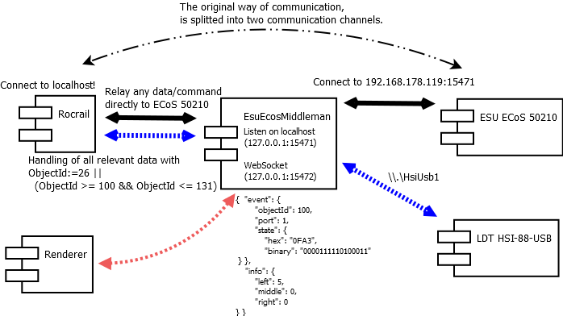
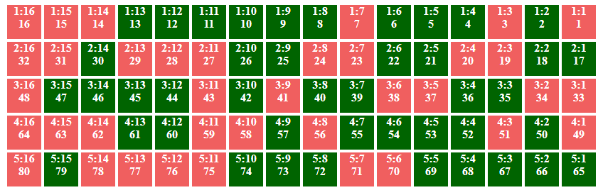
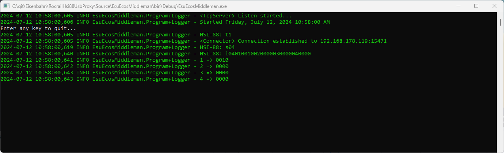
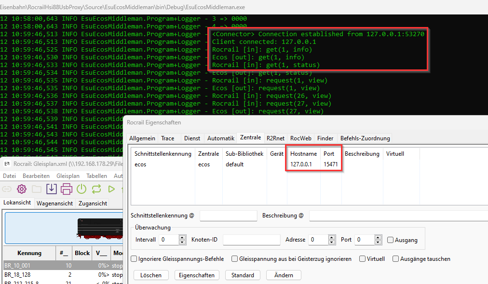
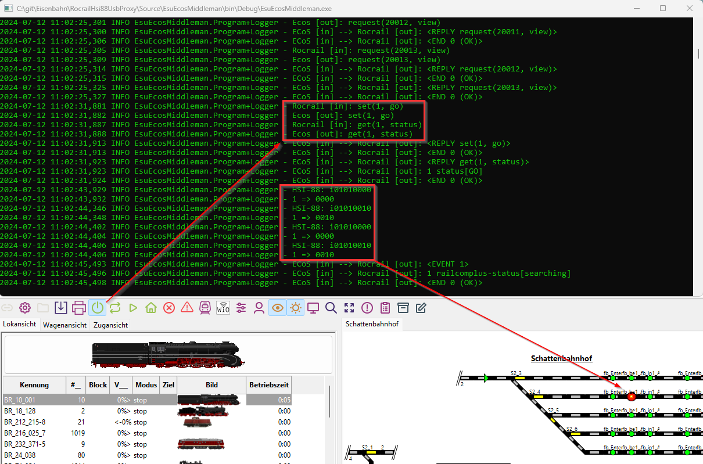
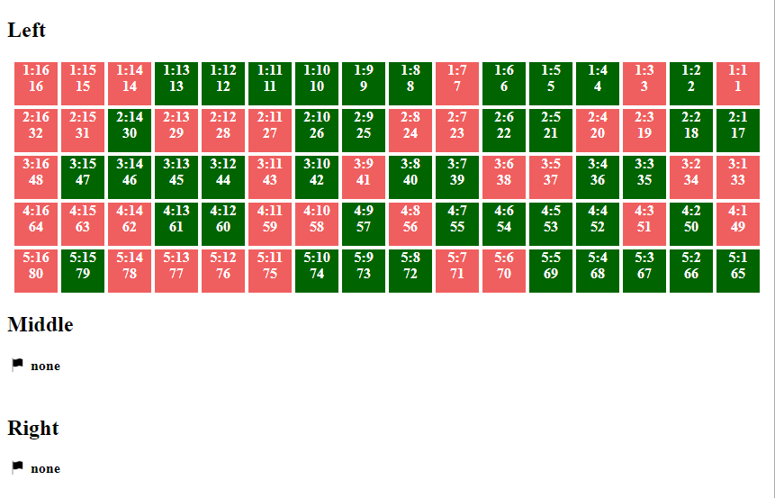

[](https://github.com/cbries/RocrailHsi88UsbProxy/actions/workflows/msbuild.yml)

[](https://github.com/cbries/RocrailHsi88UsbProxy/actions/workflows/dailyBuild.yml)

# Motivation

I used a ESU ECoS 50210 and several LDT's S88 feedback devices. In addition, with an update in May 2025, this middleware supports `ESU ECoSDetectors` as well.
After a while the ECoS' feedback device does not recognizes any input anymore, the LDT's still worked after adding an `HSI-88-N`.
But then I realized that `Rocrail` does not support the `HSI-88-USB`, only the old fashioned `HSI-88` with serial connection (no USB!).

My used hardware & software:

- `Windows PC`, running `EsuEcosMiddleman`, with the `HSI-88-USB` attached as `\\.\HsiUsb1`
- `RM-88-N`, 16-fold Standard-Feedback Module, https://www.ldt-infocenter.com/dokuwiki/doku.php?id=de:rm-88-n
- `HSI-88-USB`, High Speed Interface for the s88-Feedbackbus!, https://www.ldt-infocenter.com/dokuwiki/doku.php?id=de:hsi-88-usb
- `ESU ECoSDetector`, ECoSDetector feedback module, 16 digital input, https://www.esu.eu/products/digitale-steuerung/ecosdetector/ecosdetector/
- `ESU ECoS 50210`, https://www.esu.eu/en/products/digital-control/ecos-50210-dcc-system/what-ecos-can-do/
- - so far I used: `Rocrail`, https://wiki.rocrail.net/doku.php?id=start

# Idea

The communication protocol between the ECoS and the outside world is plaintext-based. It looks like this:

```
get(1, info)
get(1, status)
<REPLY get(1, info)>
1 ECoS2
1 ProtocolVersion[0.5]
1 ApplicationVersion[4.2.13]
1 HardwareVersion[2.1]
<END 0 (OK)>
<REPLY get(1, status)>
1 status[STOP]
<END 0 (OK)>
queryObjects(26,ports)
<REPLY queryObjects(26,ports)>
100 ports[16]
101 ports[16]
102 ports[16]
103 ports[16]
<END 0 (OK)>
get(100, state)
get(101, state)
get(102, state)
get(103, state)
<REPLY get(100, state)>
100 state[0x0]
<END 0 (OK)>
<REPLY get(101, state)>
101 state[0x0]
<END 0 (OK)>
<REPLY get(102, state)>
102 state[0x0]
<END 0 (OK)>
<REPLY get(103, state)>
103 state[0x0]
<END 0 (OK)>
```

Just connect with `telnet` (i.e. `$ telnet 192.168.178.119 15471`) or an other terminal network tool and enter the mentioned commands. 

`EsuEcosMiddleman` (so-called `ManInTheMiddle (MITM)`) runs on the Windows PC to which the `HSI-88-USB` is attached locally (for example as `\\.\HsiUsb1`). `Rocrail` may run on the same machine or on a different one. The middleware starts a local server to which `Rocrail` connects like normal and intercepts the traffic between `Rocrail` and the `ECoS`. MITM then splits the commands into two channels:

a) one for the S88 data
	
b) the second for all other data
	
It will work like a normal connection, as it would established when used directly. But the S88-data is fetched from the `HSI-88-USB` device and weaved into the data stream.

The following figure provides a bird-view of the architecture. The local proxy and the attached `HSI-88-USB` are intended to be located on the same Windows PC. `Rocrail` may run on that machine as well, but it can also run on a different computer.



In addition, an extra channel as WebSocket connection is added to allow any renderer to access the current feedback state. Open `Renderer/renderer.html` in the browser of your choice to view the web-based S88-renderer.



# Environment

Tested and build for Windows environments only.

# Release 

When any change is pushed the daily build will provide a new portable Release.

Just unzip and run the executable.

# Testbed

## Byte Order

To research the byte order structure I installed a single LDT `RM-88-N-Opto` and verified the received data. The setup commands are:

```
> t1            (send)
< t1     
> s010000       (send, one feedback device a string "left")
< s01
< i01010000
> v
< V. 1.08 / HSI-88-USB / 1.05r Win 10 (64) / (c) 2011 LDT & Flakner
> m
< m01010000
```

After the setup just connect a wire from the railroad (mass, brown/black) to the input pins of the feedback device.

Result:

```
PIN     Data from HSI-88-USB

01      i01010001
02      i01010002
03      i01010004
04      i01010008

05      i01010010
06      i01010020
07      i01010040
08      i01010080

09      i01010100
10      i01010200
11      i01010400
12      i01010800

13      i01011000
14      i01012000
15      i01014000
16      i01018000
```

# Setup 

The runtime can be configured by Json-based configuration file named `EsuEcosMiddleman.json`, it lays side-by-side to the executable within the build directory, e.g. `bin\Release\EsuEcosMiddleman.exe`.

- `hsi/devicePath` is required to address you attached `HSI-88-USB` device
- `ecos/ip` is the ip address of your ECoS

## Debouncing

It has been shown that the HSI-88-USB detects any change, as well very small triggers. Sometimes very often when trains crosses a single detection area. This can slow down any railway control software because of status/command flooding and when several logging mechanism are switched on (e.g. `log4net` with `INFO` or `DEBUG` level).

To reduce this a debouncing functionality can help. When any approach exist in the hardware directly, just it, because it will be much faster and reliable. In any other cases you can configure global debouncing walltime in `EsuEcosMiddleware.json`.

The values are milliseconds, only real pin state changes after this walltime are handled and provided to connected clients.

```json
{
  ...
    "debounce": {
      "onMs": 20,
      "offMs": 2000
    },
  ...
}
``` 

## Command Filtering

During tests it has been shown that `Rocrail` handles few commands which are not really supported by the ECoS, e.g. `Devicemanager (id=20)` (see *Netzwerkspezifikation für das PC-Interface, Version 0.2, Juni 2011*).

To minimize the dust for ECoS a filtering for commands has been implemented. Below `filter` (see configuration file `EsuEcosMiddleware.json`) object ids and object id ranges can be defined. The range is important because several commands with object ids targeting objects over `50000000` are addressed by Rocrail which do not really exist. The filtering supports the following math equations:

```csharp
/*
 *    >=      greater or equal
 *    <=      less or equal
 *    ==      equal
 *    <       less 
 *    >       greater
 */

if (c0 == '>' && c1 == '=') return objId >= GetMathPartner(equT, 2);
if (c0 == '<' && c1 == '=') return objId <= GetMathPartner(equT, 2);
if (c0 == '=' && c1 == '=') return objId == GetMathPartner(equT, 2);
if (c0 == '<'             ) return objId <  GetMathPartner(equT, 1);
if (c0 == '>'             ) return objId >  GetMathPartner(equT, 1);
```

# Runtime / Demonstration

The following screenshots show the software in action for a real model railway.







### WebUi Renderer

In addition, this software provides a web based renderer to give you direct information which feedback pins are active or not. On startup a WebSocket server is started on port `ecos.port` (see configuration file `EsuEcosMiddleware.json`), sometimes it can be required to start the application as **Administrator**. When started open `Renderer\renderer.html` in your favorite browser and the result should look like the following screenshot.

The view is split into three areas which are the representation of the `HSI-88-USB` channels, i.e. *left*, *middle*, and *right*.



# MQTT Action Extension for DCC Accessory Triggering

This project now includes a modular extension mechanism that can react to existing Rocrail/ECoS accessory commands without creating a second proxy, a second ECoS connection, or a second Rocrail listener. The extension sits in the central command-processing path and can fire an action as soon as a matching command has been parsed.

## What this feature does

The extension is deliberately additive:

- It keeps the normal proxy flow intact.
- It intercepts already-parsed commands at the central `Middleman` processing point.
- It normalizes the command into a trigger such as ObjectID `201`, port `1`, state `on`.
- It compares that trigger against configured `mappings`.
- If a mapping matches, it executes the configured action asynchronously.
- The proxy continues forwarding the command to the ECoS as usual.

This makes the feature safe for existing installations because it does not replace or duplicate the original communication path.

## Architecture

```text
Rocrail
  |
  v
RocrailHsi88UsbProxy / EsuEcosMiddleman
  |
  +-- existing parsing and forwarding
  |
  +-- Action Dispatcher (generic trigger -> action)
       |
       +-- MQTT action
       +-- later: HTTP / webhook / script / internal actions
```

The dispatcher works with the same command model already used by the proxy. A command like `set(201, state[1])` is normalized to a trigger object with:

- ObjectID: `201`
- Port: `1`
- State: `on`

This trigger is then matched against the configured mappings. A matching mapping can publish an MQTT payload to a Shelly or any other MQTT-capable device.

> Note: In JSON mappings the property name is still `trigger.address` for backward compatibility, but the value represents the ECoS ObjectID.

## Activation in the runtime configuration

The extension is enabled from the normal configuration file `EsuEcosMiddleman.json`:

```json
"extensions": {
  "actions": {
    "enabled": true,
    "mqtt": {
      "enabled": true,
      "host": "192.168.178.29",
      "port": 1883,
      "clientId": "EsuEcosMiddleman",
      "username": "",
      "password": ""
    },
    "mappings": []
  }
}
```

When `extensions.actions.enabled` is `false`, no action dispatch is performed and the original proxy behavior is unchanged. The MQTT sub-configuration can also be switched off independently if necessary.

## Example: Shelly Plus RGBW PM lighting (Gen2)

The sample setup targets a Shelly Plus RGBW PM (Gen2) using the Shelly MQTT command topic style (`.../command/rgbw:0`) with CSV payload commands.

- Device: `Shelly Plus RGBW PM`
- API generation/version: `Gen2` command API over MQTT topic `.../command/rgbw:0`

A typical lighting setup uses helper accessory ObjectIDs such as `201` through `206`:

- `201` → Day
- `202` → Evening
- `203` → Night
- `204` → Lights off
- `205` → Sunrise
- `206` → Sunset

A real configuration looks like this:

```json
{
  "name": "DayLight",
  "trigger": {
    "address": 201,
    "state": "on"
  },
  "action": {
    "type": "mqtt",
    "topic": "shelly-sky/command/rgbw:0",
    "payload": "set,true,90,220,235,255,255,5"
  }
}
```

For Gen2 devices in this mode, the MQTT Control payload format is CSV-based (`set,<on>,<brightness>,<r>,<g>,<b>,<w>,<transition_seconds>`). A similar mapping can be created for each ObjectID or any other trigger pattern supported by the action dispatch.

## Rocrail and ECoS example

A Rocrail accessory or DCC command such as:

```text
Rocrail Output "Day"
Protocol: DCC
Address: 201
```

is parsed by the existing command factory and normalized before being matched against the configured action mappings. If a mapping matches, the MQTT publish is started asynchronously and the usual forwarding to the ECoS continues immediately.

## Notes

- The normal ECoS communication flow is not duplicated.
- No second TCP listener is required for the extension.
- MQTT errors are logged and do not crash the proxy.
- The extension is intentionally generic and can later be extended with additional action types beyond MQTT.
- The system remains backward compatible with the original `RocrailHsi88UsbProxy` behavior when `extensions.actions.enabled` is off.

## Troubleshooting

- If no action fires, verify the trigger ObjectID (`trigger.address` in JSON) and the command object state in the configuration.
- If MQTT does not publish, validate `extensions.actions.enabled` and `extensions.actions.mqtt.enabled`.
- If the broker is unreachable, the proxy still continues to function; only the action is skipped.
- Use the log output to check for success messages such as `Action mapping matched` and `MQTT publish`.

